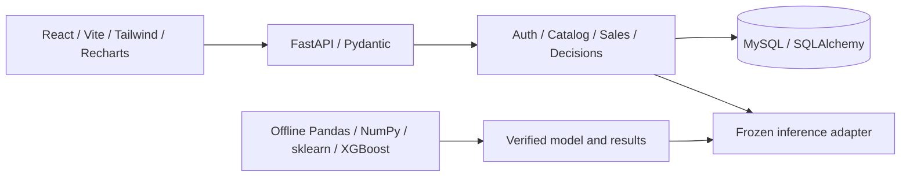
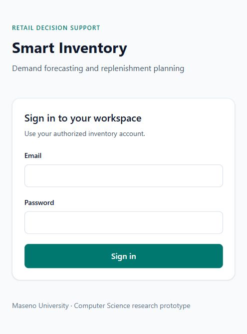

# Smart Inventory Demand Forecasting and Optimization

A web-based retail inventory decision-support prototype with reproducible machine-learning research. Fourth-year Bachelor of Science in Computer Science project at Maseno University, Kenya, by Odhiambo Amos Ochieng (`A-amos`). The [proposal](docs/Smart_Inventory_Consolidated_Five_Chapter_Proposal.docx) is the requirements authority.

The project addresses stock decisions that need reliable inventory/sales records and an estimate of future demand. It combines transaction-safe operations with historically evaluated forecasts and explainable replenishment rules for human review.

> Research uses **UCI Online Retail II historical UK data from 2009–2011**. Frozen results **do not establish current Kenyan retail forecasting accuracy**. Compatible inference history ends 2011-11-10. Current unsupported/stale forecasts are rejected; UNASSESSED does not mean adequate. No automatic purchasing occurs.

## Features

- Authorized manager/researcher sessions, Argon2id passwords, expiry, revocation and lockout.
- Categories/products, unique SKUs, archival and replenishment settings.
- On-hand, confirmed incoming, allocations, inventory versions and movement audit history.
- Atomic operational sales, locked stock, overselling prevention, rollback and retry protection.
- Historical CSV preview/confirmation, retained rejections and duplicate protection, without stock changes.
- Genuine mean/seasonal baseline, Random Forest and XGBoost comparison with chronological evaluation.
- Explicit supported SKU mapping, frozen inference and immutable forecast/decision histories.
- Explainable risk/reorder quantities and interactive Recharts dashboard/model comparison.

## Architecture and stack



A modular N-tier monolith separates interface, request validation, services, persistence and offline research. Training never runs in a web request. Compose runs MySQL, migration job, API and local frontend server. [Architecture](docs/ARCHITECTURE.md), [database](docs/DATABASE.md), [API](docs/API.md).

```text
backend/       FastAPI, services, schemas, models, migrations and tests
frontend/      React forms/dashboard, pnpm lockfile and tests
ml/            Frozen-protocol research, inference, tests and tiny artifact
data/          Derived development history; raw/full processed data ignored
scripts/       Setup, acquisition and actual verification tools
docs/          Proposal, diagrams, research, test evidence and student guides
compose.yaml   Local database/API/frontend startup
```

## Prerequisites and setup

Docker Desktop with a running Compose-capable engine. Native testing requires Python 3.12, Node 22.12+ or 24 and pnpm 11 (package metadata pins 11.19.0). Final native verification used Python 3.12.14, Node 24.19.0 and pnpm 11.25.0; containers use Python 3.12/Node 22. No external account is needed to run locally. First image build downloads scientific dependencies and can be slow.

From the project directory in PowerShell:

```powershell
python scripts/create_local_env.py
docker compose up --build -d
docker compose ps --all
docker compose exec -T backend alembic current
docker compose exec -T backend alembic check
docker compose exec backend python -m app.bootstrap --email manager@example.com --name "Inventory Manager"
```

The environment generator creates local random database credentials once, preserving an existing `.env`. Bootstrap privately prompts for a new password; there is no default password/public registration. Open **http://localhost:5173**, sign in and choose a workspace page. API docs: **http://localhost:8000/docs**; readiness: **http://localhost:8000/api/v1/health/ready**. Current migration head: `e52ad70491b2`. All ports bind localhost; the Compose frontend is a development server, not remote production hosting.

On the original laptop, if Docker is not on PATH, replace `docker` with `& 'C:/Users/user/AppData/Local/Programs/DockerDesktop/resources/bin/docker.exe'`. Stop safely using `docker compose stop`. **Never reset/delete the database, downgrade migrations or run `docker compose down -v` without explicit approval.**

[Installation](docs/INSTALLATION_GUIDE.md) · [User manual](docs/USER_MANUAL.md) · [Supervisor demo](docs/DEMO_GUIDE.md) · [Beginner study guide](docs/HOW_THE_SYSTEM_WORKS.md) · [Defense answers](docs/PROJECT_DEFENSE_GUIDE.md).

## Sales and historical CSV import

Operational sales consume physical unallocated stock and commit sale, stock and audit together. The same unchanged UUID can be retried without a second sale. Incoming stock does not authorize an immediate sale.

Historical UTF-8 CSV requires `sku,sale_date,quantity`; optional `unit_price,external_id`. Use timezone-aware timestamps, positive quantities and optional nonnegative KES prices. Limit: 1 MiB/5,000 rows. Preview retains every rejection; explicit valid-only confirmation expires after 30 minutes. File/row identities prevent duplicates. **Historical imports never change current stock.** [Complete import rules](docs/SALES_IMPORT.md).

## Forecasting research and model results

The study uses 60 training-selected UK online gift/wholesale SKUs. Initial training ends 2011-09-15. Two expanding validation origins precede final origin 2011-11-10 and targets 2011-11-11 through 2011-12-08. Prior-only features prevent future actual demand/price leakage. Selection by validation MAE, then RMSE/name, was frozen before final labels.

| Finalist | Validation MAE | Validation RMSE | Final MAE | Final RMSE |
|---|---:|---:|---:|---:|
| **mean_28 — selected** | 4.753635 | 36.360016 | 5.335034 | 17.944564 |
| Seasonal naive | 6.078274 | 43.352902 | 4.939881 | 17.008524 |
| Random Forest, leaf5 | 10.080747 | 42.761740 | 6.545169 | 18.516365 |
| XGBoost, depth5 | 9.193968 | 46.835325 | 5.615669 | 18.846317 |

Final candidates use 1,680 identical SKU-day targets. MAPE is omitted because 1,169 actuals are zero. Seasonal naive had lower final error; changing selection from final labels would bias evaluation. Mean_28 remains the legitimately selected baseline. [Dataset](docs/research/DATASET.md), [EDA](docs/research/EDA.md), [protocol](docs/research/EXPERIMENT_PROTOCOL.md), [comparison](docs/research/MODEL_COMPARISON.md), [final model](docs/research/FINAL_MODEL.md).

Managers explicitly map a supported UK StockCode to a unit-count product with a reason and historical-demo acknowledgement. Valid demonstration origin 2011-11-10/horizon 1–28 produces immutable forecasts. Arbitrary application imports do not automatically become compatible research history. After installing native dependencies, verify real frozen inference without retraining:

```powershell
.venv/Scripts/python.exe scripts/verify_publication_preservation.py
```

Do not run training/export/original CLI inference over preserved results: some commands write historical evidence. [Independent reproduction](ml/README.md) uses a new ignored workspace and the original historical lockfile, which retains documented advisories and must stay isolated. Application upgrades preserve frozen direct ML versions, protocol, artifact and results.

## Decision support

Position = on-hand + confirmed incoming − allocated. Target = forecast lead-time demand + safety stock. Reorder = max(0, target − position). Position strictly above target × multiplier gives OVERSTOCK; shortage gives REPLENISH. Missing applicable evidence gives UNASSESSED. All confirmed incoming is assumed within lead time because no ETA is recorded; quantities are fractional without pack/cost optimization.

Every immutable decision retains inputs, assumptions and stock/configuration/model/date versions. Later edits never rewrite it. Recommendations require human review and execute no purchase. [Decision rules and boundaries](docs/DECISION_SUPPORT.md).

## Testing and evaluation

```powershell
python -m venv .venv
.venv/Scripts/python.exe -m pip install -r backend/requirements-dev.txt -r ml/requirements.txt
.venv/Scripts/python.exe -m pytest backend/tests -c backend/pytest.ini
.venv/Scripts/python.exe -m pytest ml/tests
Push-Location frontend
pnpm install --frozen-lockfile
pnpm test
pnpm build
Pop-Location
```

Finalization reran **163 backend + 59 ML + 29 frontend = 251 tests**, passing with one upstream TestClient deprecation; production build passes. Backend tests use temporary SQLite; live scripts separately verify actual MySQL locking, persistence, rollback, permissions, imports and immutability. ML unit tests use synthetic fixtures, separately from real experiments. Frontend requests are mocked; real API/browser evidence is separate. [Publication review](docs/PUBLICATION_REVIEW.md) records final Docker/live verification, audits, versions, warnings and pending publication actions.

**23 of 24 proposal cases passed; TC24 remains pending external participant evaluation.** Zero participants and zero responses; [instrument prepared](docs/USABILITY_EVALUATION.md). Edge had a bounded observed workflow; Chrome/Firefox follow-up may remain policy-blocked. No commercial effectiveness, penetration test or enterprise capacity is claimed. [Cases](docs/test-results/final-24-test-cases.md), [traceability](docs/OBJECTIVE_TRACEABILITY.md), [Chapter 4](docs/academic/CHAPTER_4_EVIDENCE.md), [Chapter 5](docs/academic/CHAPTER_5_EVIDENCE.md), [limitations](docs/SYSTEM_LIMITATIONS.md).

## Screenshots

Actual synthetic/historical demonstration: [dashboard](docs/screenshots/final/dashboard.jpg), [inventory/audit](docs/screenshots/final/inventory-history.jpg), [CSV preview](docs/screenshots/final/csv-import-preview.jpg), [forecast/recommendation](docs/screenshots/final/recommendation.jpg), [all screens](docs/screenshots/final/README.md).



## Data, publication and academic use

Raw archives/workbook, customer identifiers, full training/sealed data, credentials, `.env`, virtual environments, node_modules, caches and local database data stay ignored. The repository includes only the verified **356-byte baseline artifact** and **1.2 MB daily development aggregate** (date/SKU/demand/price; no customer/invoice identifiers), so a clone can run the frozen demo without retraining. `.gitattributes` preserves exact bytes: newline conversion would break research fingerprints. No Git LFS is needed. Original acquisition/reconstruction instructions remain in the research docs; do not overwrite evidence to recreate an artifact.

Attribution: Chen, D. (2012), [Online Retail II, UCI](https://archive.ics.uci.edu/dataset/502/online%2Bretail%2Bii), DOI [10.24432/C5CG6D](https://doi.org/10.24432/C5CG6D), [CC BY 4.0](https://creativecommons.org/licenses/by/4.0/). The aggregate is derived through documented filtering/aggregation; research prices are GBP, not operational KES. No general open-source software license has been selected: [academic/data notice](NOTICE.md). [Development log](DEVELOPMENT_LOG.md) preserves commands, actual failures/fixes and remaining limits.
