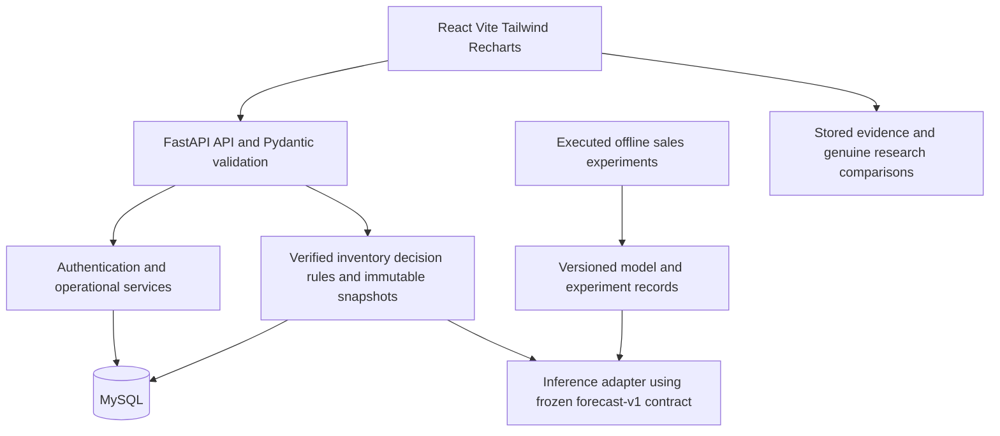

# Software architecture

The proposal's Figure 3.1 and sections 3.10–3.13 specify modular N-tier separation. The implementation uses a React presentation tier, FastAPI request/schema/authentication tier, independent application/decision services, a Python forecasting module and MySQL relational persistence. The forecasting component is a module with offline training, not a mandatory network service.

`backend/app/api` owns HTTP mapping; schema modules own Pydantic contracts; `services` owns authentication/catalog/stock/sales/import and inventory decision rules; `models.py` and `database.py` own persistence. React Workspace provides category, product, inventory, audit, sales-entry/history, CSV preview/confirmation and lazily loaded dashboard views. Every mutation checks the manager role on the server; researchers view records. Catalog archives preserve references and can be restored. Stock edits compare the loaded version after a current locked read and commit the movement with the stock change. `ml` owns offline research preparation/experiments/frozen evaluation. Phase 5 adds `forecast_runtime.py` to verify hashes/versions and invoke its unchanged artifact loader and forecast-v1 inference contract. Training never runs in an HTTP request. Normal stock/sales/import modules do not load the model, providing failure isolation. `data` contains ignored raw/processed datasets; Docker includes only checked development history for inference, excluding raw customer records and sealed holdout. `docs` holds technical/research evidence. Routes use `/api/v1`; autogenerated OpenAPI is the executable contract.

Browser sessions use a random bearer token held only in React memory. Only its SHA-256 digest is persisted; expiration, disabled accounts and logout are checked server-side. Browser reload requires sign-in. Passwords use Argon2id. Five wrong passwords lock an existing account for 15 minutes. This is a prototype control; shared-edge rate limiting and transport TLS are deployment concerns to validate before exposure beyond localhost. Database errors return a safe 503. Operational pages remain protected as they are added.

Containers are bound to localhost. Vite proxies `/api` to FastAPI, allowing a common browser origin in development. Compose waits for MySQL readiness, runs Alembic, then starts API/frontend. Production hosting is outside this phase; the Vite development container is a local prototype launcher.

Design refinements: one current-stock row/product; normalized categories; separate revocable session table. Phase 5 forecast and recommendation records reference the preserved registry model ID/version/digest rather than duplicating frozen experiments in a mutable model-run table. Explicit namespaced series mappings, dated per-day points and immutable JSON decisions preserve provenance. These implement the conceptual ERD whose exact storage/cardinality was deferred. No new domain service process is required.

Phase 5 keeps the research/application identity boundary explicit. Managers append supported UK series mappings for individual-count products, with reason/acknowledgement; SKU/unit changes invalidate mappings. Forecast requests call `predict`, never `fit`; recommendations lock stock/configuration and write evidence only. UUID retry keys prevent duplicate evidence; ORM guards plus MySQL triggers reject UPDATE/DELETE. The dashboard distinguishes current UNASSESSED inventory from the acknowledged 2011-11-11 research scenario. Original research dates are never shifted; current forecasting needs new compatible data under a later approved research increment. See DECISION_SUPPORT.md for formulas, failures and UK/Kenya limitations.

Phase 3 keeps the proposal's N-tier modular monolith. The sales service commits operational sale, locked-stock decrement and linked audit atomically. A separate bounded CSV parser/preview service persists validated selections and explicit rejection evidence; confirmation writes historical sales without current-stock side effects. Request/file/row identities support retry and repeat-import protection. No import worker, domain microservice, forecasting model, procurement execution or enterprise infrastructure was added. See SALES_IMPORT.md for operational versus historical semantics and duplicate policy.

## Phase 6 verified refinement and evaluation

Architecture remains unchanged. Four measured concurrent-sale503responses were caused by unique-request-key gap-lock deadlocks. The existing sales service retries only MySQL1213 after complete rollback, up to three total attempts, with the same UUID and fresh stock/version checks. Stale/insufficient-stock conflicts and ambiguous connection failures are not retried. Three regression cases and a repeat440-request run verify the fix. See test-results/PERFORMANCE.md and backend/tests/test_sales.py. All31protected research/source hashes remain unchanged. Objective/evaluation boundaries are in OBJECTIVE_TRACEABILITY.md and SYSTEM_LIMITATIONS.md.
