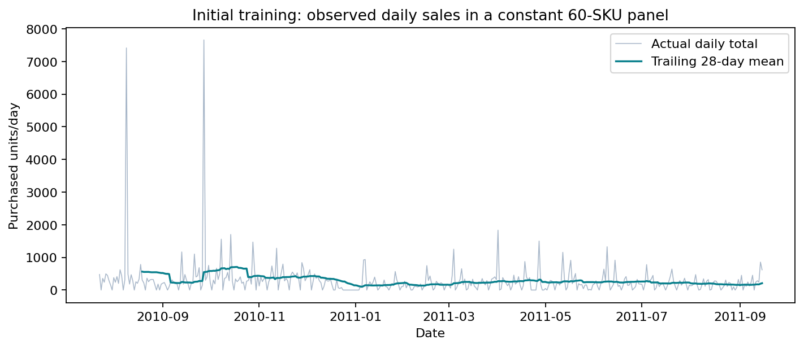
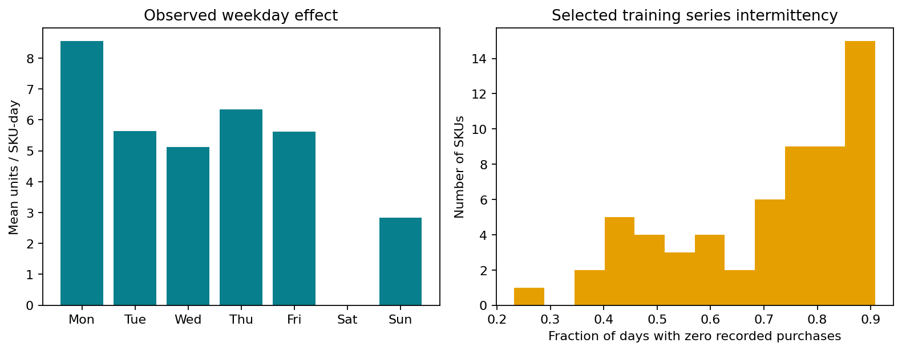
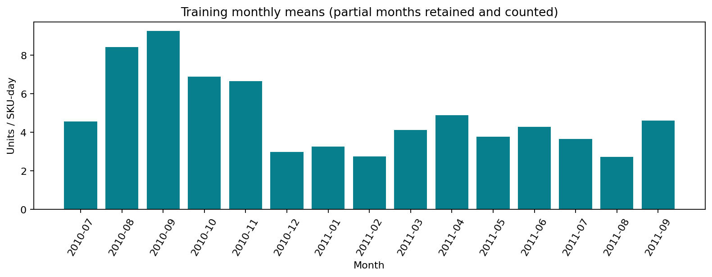
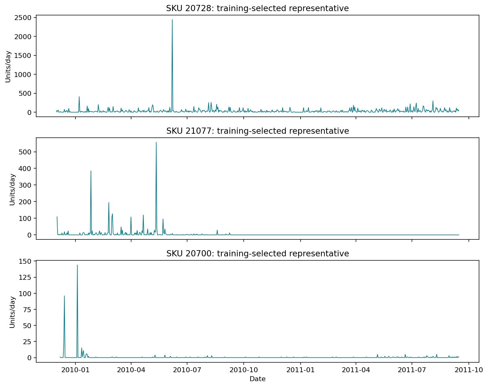

# Initial-training exploratory analysis

Executed analysis uses **37,753 daily observations across 60 training-selected SKUs**, 2009-12-01 to 2011-09-15. Validation and final-test targets are excluded. Source workbook structure and rejection counts are audited across the export for provenance; behavioral analysis is training-only.

The workbook contains 1,067,371 rows, 8 columns, 5,305 distinct raw StockCode values and 43 destination countries. These include non-product codes. There is one UK-based online retailer; no store or category identifier and no promotion/event table is provided. Customer countries are destinations, not stores.

Missing source descriptions: 4,382; missing Customer IDs: 243,007. Neither field enters forecasting. Core date, price, quantity, invoice and stock-code fields have no nulls, although invalid values/non-product codes and cancellations require filtering. Overlapping masks and exclusive rejection counts are in results/preprocessing.json; 1,003,214 records remain after documented filtering. Exact duplicate candidates: 34,335; exclusive duplicate rejections: 33,663. Repeated identical export rows are assumed duplicates; indistinguishable legitimate repeated invoice lines remain a data limitation.

Initial-training cohort decisions: {'eligible_not_selected_seeded_sample': 1932, 'history_under_365_days': 665, 'included': 60, 'no_initial_training_history': 194, 'positive_days_under_60': 1856}. Eligibility concerns products with initial-training history only; future-only/new products are outside the fixed vocabulary. The sample is 20 SKUs from each zero-fraction stratum. Exact IDs/statistics are in results/cohort.csv; sampling is not based on validation/test error.

Zero-recorded-purchase days: **26,891 (71.23%)**. Median per-SKU zero fraction: 76.89%; median average demand interval: 4.33 days. No recorded transaction means zero under the complete-export assumption, not proof that demand is absent. Unobserved availability/stockouts cannot be resolved. Positive-demand CV squared and per-SKU statistics are saved in eda/sku-summary.csv.

The constant 60-SKU panel starts 2010-07-23 and contains 420 calendar days. Weekday mean units per SKU-day (Mon–Sun): 8.56, 5.63, 5.13, 6.35, 5.61, 0.00, 2.83. Saturday is particularly sparse in this export; business operating patterns can explain weekday associations. Median lag-7 autocorrelation is 0.046. Monthly means/trailing daily totals show changing volumes and seasonal gift-retail patterns, but fewer than two full annual cycles, partial months and wholesale orders prevent strong causal or stable annual-seasonality claims.

All 60 selected SKUs show variation in observed or carried prices; median price-demand Spearman association is -0.069. Quantity-weighted daily transaction prices reflect customer/wholesale mix, not a known advertised price. These associations do not establish a price effect. Future prices are prohibited; forecasting carries the last known price.

Upper three-IQR daily flags: 4,635; largest selected training daily purchase: 7,008 units. All flagged quantities are retained, since high purchases may be legitimate wholesale orders. Flagged rows are saved for review; they are not removed to improve scores.

EDA supports prior demand/calendar and past price features, weekly and mean baselines, and tree models for nonlinear associations. It does not guarantee their superiority; selection remains an empirical validation comparison. No Kenyan retail performance is inferred.
