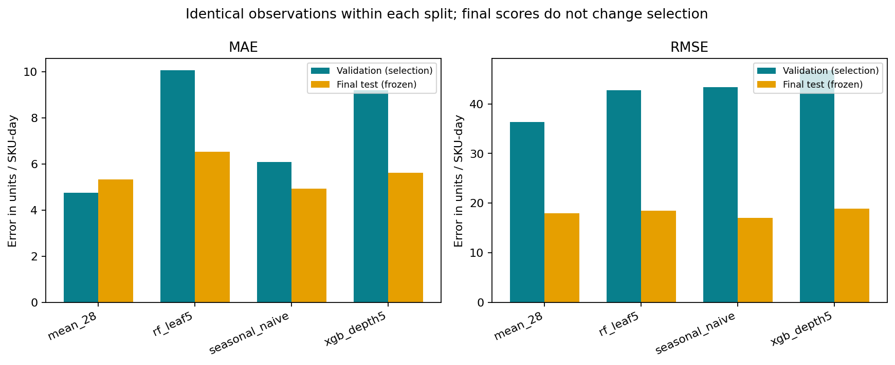
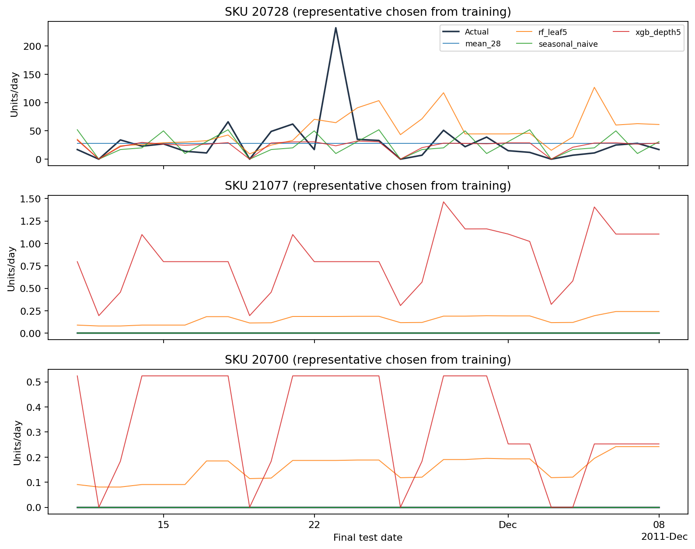

# Executed forecasting comparison

The validation-only winner is **mean_28**, frozen at 2026-09-30T22:55:08.275037+00:00; the final test was accessed at 2026-09-30T22:58:57.313109+00:00. Model selection used pooled validation MAE, then RMSE/name, including baselines. It did not use final-test rankings. The best configuration from each tree family and both baselines were frozen before the final test. The other two configurations were not run against final labels.

| Candidate | Validation MAE | Validation RMSE | Final MAE | Final RMSE | Final observations |
| --- | ---: | ---: | ---: | ---: | ---: |
| mean_28 | 4.753635 | 36.360016 | 5.335034 | 17.944564 | 1680 |
| seasonal_naive | 6.078274 | 43.352902 | 4.939881 | 17.008524 | 1680 |
| xgb_depth5 | 9.193968 | 46.835325 | 5.615669 | 18.846317 | 1680 |
| xgb_depth3 | 9.327391 | 43.942535 | Not a frozen finalist | — | — |
| rf_leaf5 | 10.080747 | 42.761740 | 6.545169 | 18.516365 | 1680 |
| rf_leaf15 | 10.093938 | 39.320707 | Not a frozen finalist | — | — |

Every validation candidate forecasts the same 3,360 SKU/origin/day targets (60 SKUs × two 28-day windows). Every final candidate forecasts the same 1,680 targets (60 × 28), 2011-11-11 through 2011-12-08. Both dates and actual quantities are checked across models; no missing observations are silently removed. MAE/RMSE are pooled equally per SKU-day and measured in purchased units, not percentages. MAPE is omitted for zero/intermittent sales. Final-test zero days: 1169 / 1680 (69.58%).

The validation-selected model's final MAE changes by -8.00% relative to seasonal naive (positive denotes lower error). Raw predictions, per-SKU metrics, exact effective fitted parameters, training/inference timings, seeds, dependency versions and data/code hashes are preserved in results/. The selected model remains mean_28 even if another model has lower final error. No confidence intervals or statistical significance are claimed from this one final horizon. Validation/test seasonal regimes differ, and pooled means can hide weak SKUs.

Worst ten selected-model products by final MAE (all retained):

| SKU | MAE | RMSE | Zero days / 28 |
| --- | ---: | ---: | ---: |
| 22595 | 80.0000 | 83.5628 | 7 |
| 71477 | 50.1327 | 86.9033 | 7 |
| 20728 | 22.3878 | 42.7152 | 4 |
| 20982 | 15.5357 | 22.1225 | 5 |
| 85048 | 12.9082 | 18.8713 | 5 |
| 22440 | 11.0714 | 19.9643 | 15 |
| 22082 | 10.3214 | 14.8649 | 8 |
| 22529 | 10.1964 | 12.4369 | 16 |
| 85061W | 9.5663 | 10.9961 | 12 |
| 22716 | 9.2857 | 10.1970 | 13 |

Figures show the frozen finalist errors and the three representative SKUs selected before training from the zero-fraction strata. Full per-SKU performance is in final-test-by-sku.csv. Investigating these failures is descriptive; it does not trigger test-driven retuning. Bulk purchases, intermittent zeros, missing inventory availability and fixed-origin recursive error can all limit observed-sales prediction. The 60-SKU UK gift-retail case study is not a universal or Kenyan-performance estimate.

